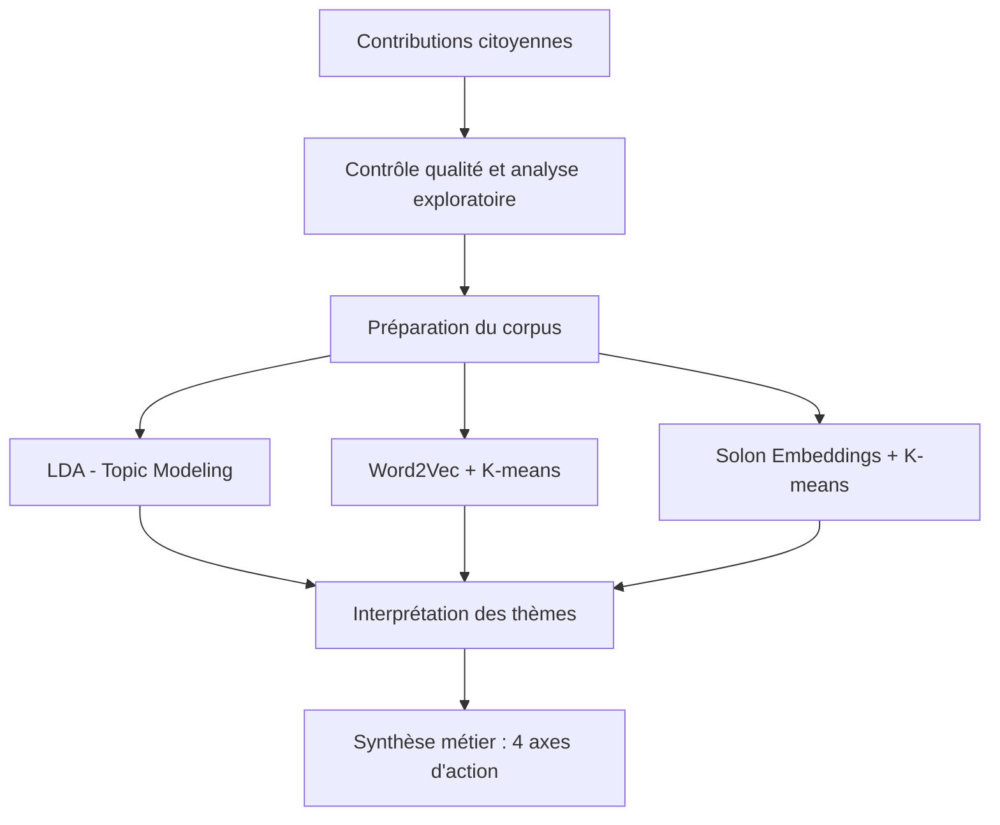

# Analyse NLP d'une consultation citoyenne sur la sobriété numérique

**Natural Language Processing (NLP) · Text Mining · Topic Modeling · Semantic Clustering**

Projet réalisé dans le cadre de la formation à l’ENSAI, à partir d’une consultation citoyenne initiée par Orange sur la plateforme Make.org.

**Auteurs :** A. Tavsiev et Deogratias Allakonon.

## 1. Contexte et problématique

La réduction de l’empreinte environnementale du numérique constitue un enjeu pour les opérateurs, les fabricants d’équipements et les utilisateurs. Pour recueillir des pistes d’action, Orange a initié une consultation citoyenne autour de la question suivante :

> Comment pouvons-nous réduire ensemble les impacts environnementaux du numérique (équipements, usages internet, mobile, vidéo…) ?

L’objectif du projet est de transformer plusieurs milliers de contributions textuelles non structurées en thèmes interprétables et en leviers d’action, grâce au traitement automatique du langage naturel et à l’apprentissage non supervisé.

## 2. Résultats clés

| Indicateur | Résultat |
| --- | ---: |
| Contributions analysées (analyse Solon) | 5 069 |
| Participants mobilisés à l'échelle de la consultation | Plus de 150 000 |
| Votes exprimés à l'échelle de la consultation | Plus de 2,6 millions |
| Thèmes identifiés par Word2Vec + K-means | 8 |
| Thèmes identifiés par Solon + K-means | 12 |
| Grands axes d'action issus de la synthèse | 4 |

## 3. Données et analyse exploratoire

Le corpus est constitué de propositions citoyennes en français, accompagnées d'informations permettant de contextualiser les contributions : votes, territoire et profil des participants.

Les contrôles de qualité ont mis en évidence :

- 100 % des textes renseignés et en français ;
- environ 18 mots par proposition en moyenne ;
- environ 66 % de codes postaux manquants ;
- environ 16 % d'âges manquants.

L'analyse exploratoire porte sur la participation géographique et par tranche d'âge, ainsi que sur les idées consensuelles et controversées. Les distributions géographiques et démographiques doivent être interprétées sur le périmètre des données renseignées, sans prétendre représenter l'ensemble de la population.

## 4. Pipeline méthodologique

### Approche 1 — Latent Dirichlet Allocation (LDA)

Modélisation probabiliste des sujets à partir des cooccurrences de mots. Huit topics sont regroupés en trois grands leviers : sobriété des infrastructures, sobriété des usages et durabilité des équipements.

### Approche 2 — Word2Vec + K-means

Apprentissage de représentations vectorielles des mots à partir de leur contexte dans le corpus, représentation numérique des propositions et regroupement par K-means.

Le nombre de clusters retenu est **k = 8**. L'interprétation s'appuie notamment sur les dix propositions les plus représentatives de chaque cluster.

| Cluster | Thème |
| --- | --- |
| 0 | Data centers responsables |
| 1 | Sensibilisation des utilisateurs |
| 2 | Extinction des box |
| 3 | Réduction du streaming |
| 4 | Équipements durables |
| 5 | Nettoyage des mails |
| 6 | Remise en question de la 5G |
| 7 | Forfaits sobres |

### Approche 3 — Solon Embeddings + K-means

Utilisation d'un modèle d'embeddings adapté au français afin de représenter le sens global des propositions. Le clustering regroupe ainsi des formulations différentes exprimant des préoccupations similaires.

Cette approche fait émerger **12 thèmes**, avec des groupes jugés plus naturels à interpréter dans la restitution. Aucun thème ne concentre à lui seul la majorité des contributions.

## 5. Principaux enseignements

Quelques thèmes issus de l'analyse Solon (part des propositions, et non taux d'approbation) :

| Thème | Part |
| --- | ---: |
| Réparer, recycler et rendre les équipements plus durables | 13,5 % |
| Rendre visible l'impact carbone des usages numériques | 11,2 % |
| Garder son smartphone plus longtemps | 10,9 % |
| Limiter la publicité, les spams et les sollicitations inutiles | 9,9 % |
| Mutualiser les box, réseaux et équipements | 9,0 % |

L'analyse des votes complète cette lecture : deux propositions portant sur la réparabilité et l'allongement de la durée de vie des équipements atteignent chacune 97 % d'accord, tandis que certaines mesures tarifaires ou fiscales recueillent jusqu'à 50 % de votes contre.

## 6. Recommandations métier

| Axe | Pistes d'action issues des contributions |
| --- | --- |
| Infrastructures et réseaux | Énergies renouvelables, récupération de chaleur des serveurs, mutualisation des équipements, réflexion sur le déploiement de la 5G. |
| Usages plus sobres | Réduction du streaming énergivore, limitation des spams et de la publicité, nettoyage des mails. |
| Équipements plus durables | Allongement de la durée de vie, réparation, recyclage, extinction des équipements inutilisés. |
| Information et incitations | Sensibilisation, visibilité de l'impact carbone, réflexion sur les forfaits et la tarification à l'usage. |

Ces résultats fournissent une grille de lecture des attentes citoyennes susceptible d'éclairer une stratégie de numérique responsable. Ils ne constituent pas une mesure de l'efficacité environnementale réelle des actions proposées.

## 7. Compétences mobilisées

- Analyse exploratoire de données et contrôle qualité.
- NLP et analyse de corpus francophones.
- Topic modeling avec LDA.
- Word embeddings et sentence embeddings (Word2Vec, Solon).
- Machine learning non supervisé et clustering K-means.
- Interprétation de clusters et restitution des résultats à des interlocuteurs métier.

## 8. Documentation du projet

- [Présentation des résultats de la consultation citoyenne Orange](Presentation%20des%20resultats_Consultation%20citoyenne%20orange.pdf) — contexte, méthodologie, visualisations, résultats et recommandations.

Les scripts, notebooks, données sources, dépendances et paramètres détaillés n'ayant pas été fournis lors de la rédaction de cette documentation, aucune procédure d'exécution vérifiée n'est proposée.

## 9. Limites et perspectives

- Données sociodémographiques et géographiques partiellement renseignées.
- Interprétation des clusters dépendante de la représentation textuelle et du choix du nombre de groupes.
- Absence de métriques quantitatives comparatives dans le support disponible : la préférence pour Solon repose sur l'interprétabilité présentée, non sur une supériorité chiffrée démontrée.
- Perspectives : évaluer la stabilité des clusters, mesurer leur cohérence sémantique, valider les thèmes par annotation humaine et croiser les thèmes avec les votes.

## 10. Confidentialité et droits de diffusion

Les données de consultation et les documents de tiers doivent être diffusés uniquement si les droits et autorisations applicables le permettent. Ne pas publier de données personnelles ou de fichiers sources sans autorisation.

---

**Projet académique — ENSAI | NLP, Text Mining, Unsupervised Learning & Digital Sustainability**
